<div align="center">

# Black Friday da Personal Trainer Academy

**12 páginas de captura, kit de elementos gráficos e identidade visual da campanha _Black PTA ao Vivo_**

[](https://black-pta-sites.vercel.app/)


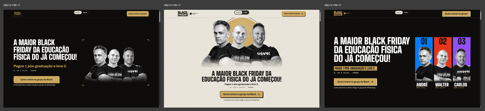

</div>

---

## O que é este repositório

A campanha **Black Friday da Personal Trainer Academy** tem uma marca-mãe (dourada) e **três produtos**, cada um com
um professor e uma cor própria. Aqui está tudo que foi feito para as páginas dela:

| | Produto | Professor | Cor |
|---|---|---|---|
| 🔵 | **Biomecânica** | André Albuquerque | Azul `#007BFF` |
| 🔴 | **Bodybuilding e Estética Corporal** | Walter Krause | Vermelho `#E8341C` |
| 🟣 | **Treinamento Feminino** | Carlos Garon | Roxo `#934EFF` |
| 🟡 | **As três juntas** (marca-mãe) | — | Ouro `#CDA85E` |

> **Isto é um projeto de teste.** Nada aqui é entrega final aprovada. Os textos são a copy do cliente, as fotos dos
> professores ainda **não têm termo de autorização de imagem** e o formulário roda em modo demonstração.

---

## As 12 páginas

Todas existem nos **dois temas** (escuro e claro) e já estão publicadas para teste:
**[black-pta-sites.vercel.app](https://black-pta-sites.vercel.app/)** (índice com os 12 links).

### Páginas-mãe · ouro na oferta das três juntas

| Sala de controle · `/v1/` | Dossiê · `/v2/` | Placar · `/v3/` |
|:---:|:---:|:---:|
| 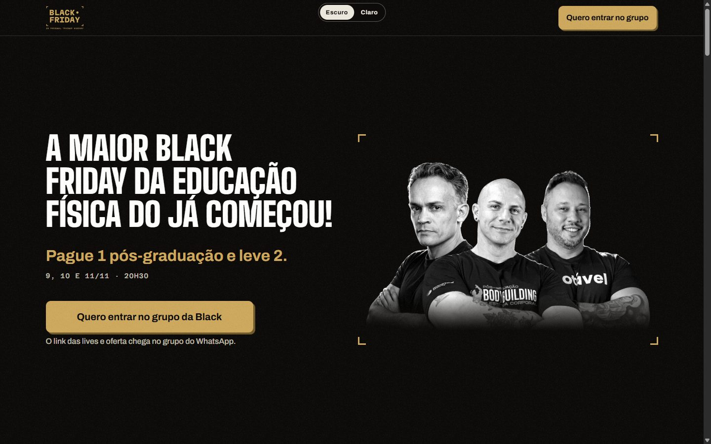 | 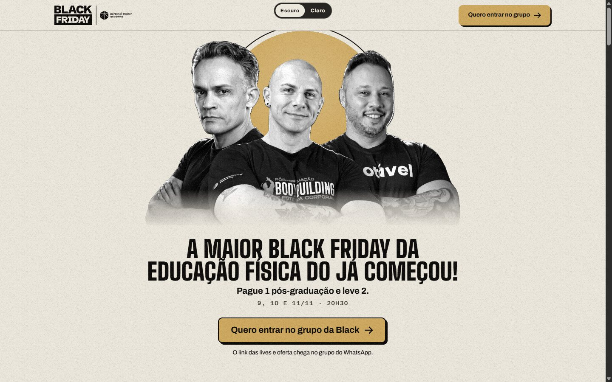 | 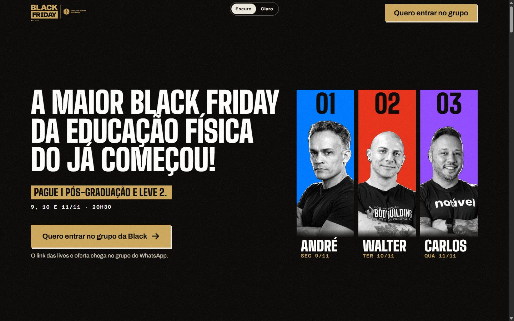 |

### Páginas de professor · cada uma com a cor do seu professor (sem dourado)

| | v1 | v2 | v3 |
|---|:---:|:---:|:---:|
| 🔵 **André** · Biomecânica<br>`/solo/andre/` | 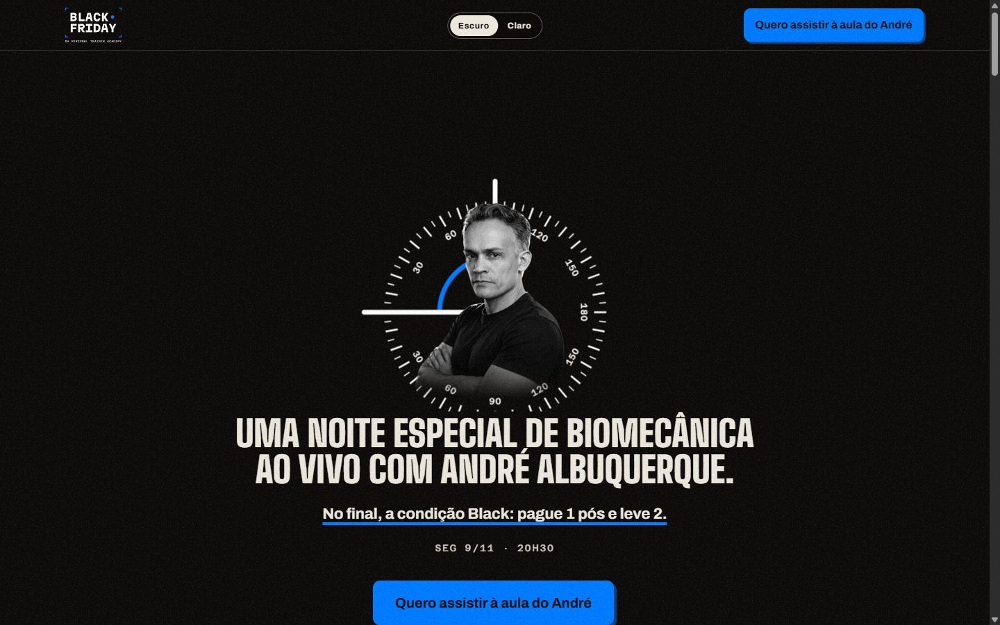 | 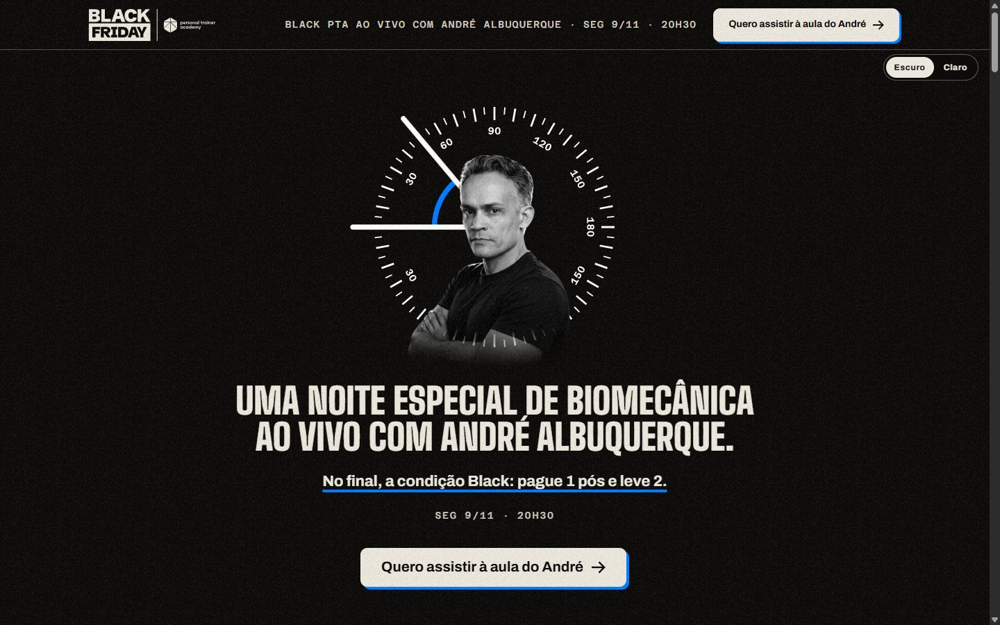 | 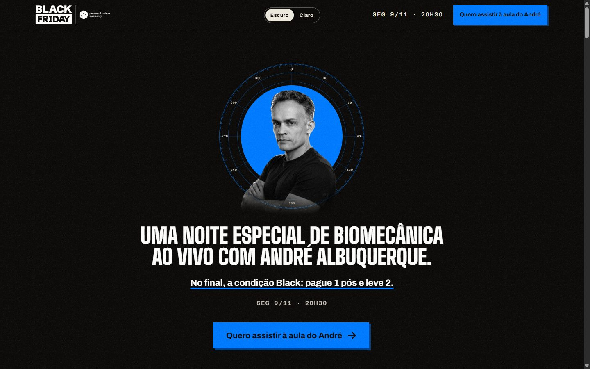 |
| 🔴 **Walter** · Bodybuilding<br>`/solo/walter/` | 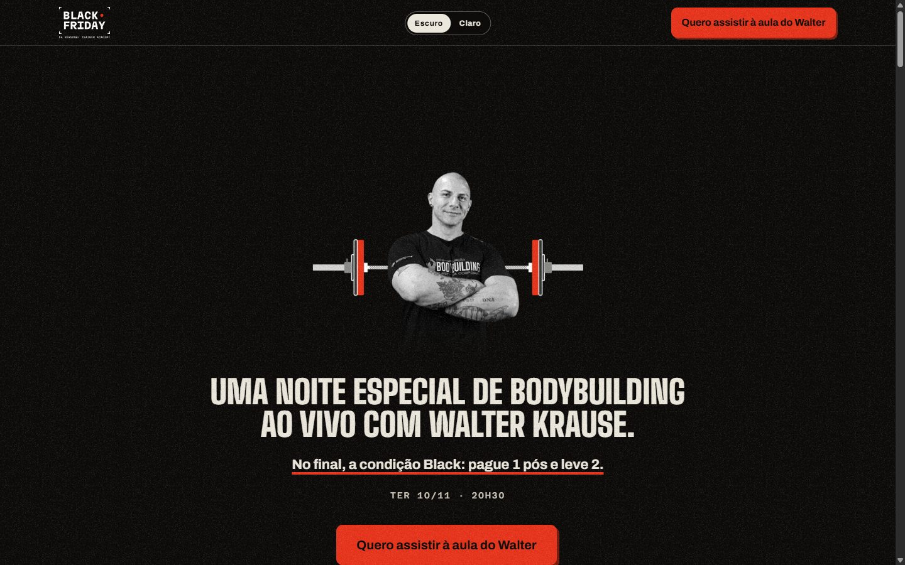 | 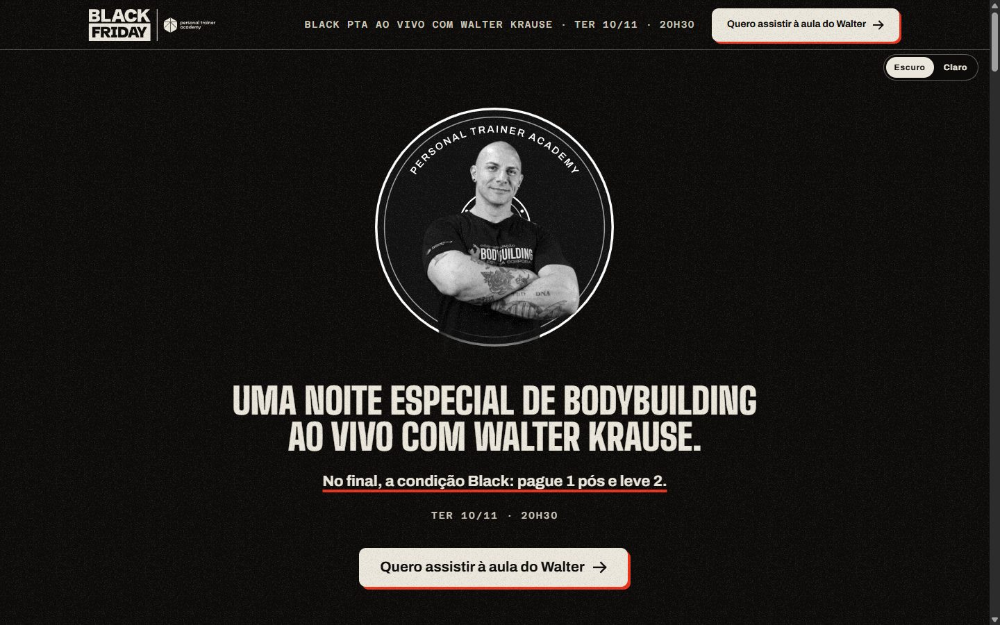 | 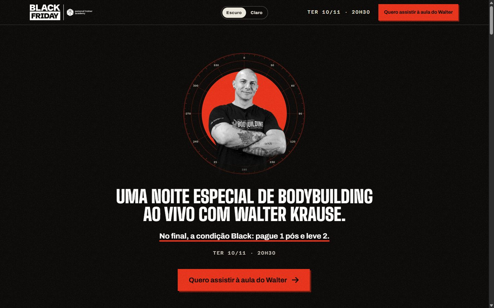 |
| 🟣 **Carlos** · Feminino<br>`/solo/carlos/` | 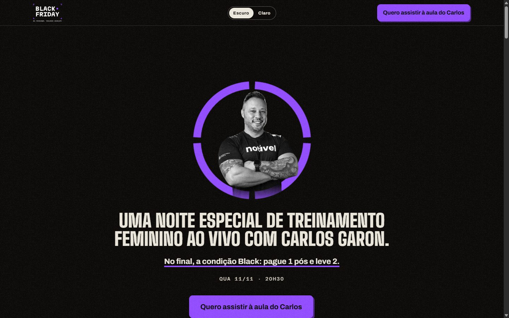 | 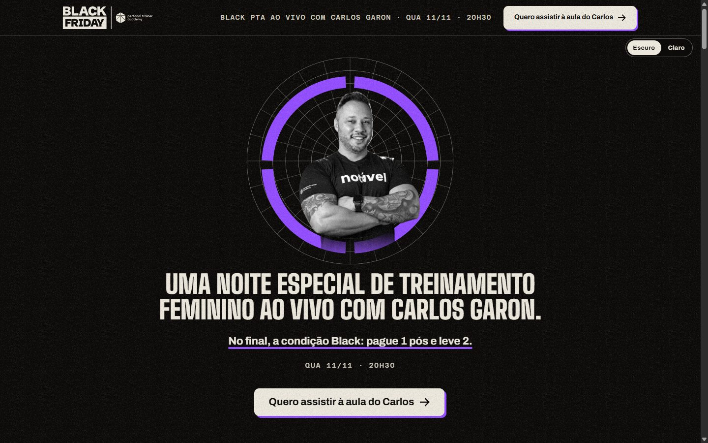 | 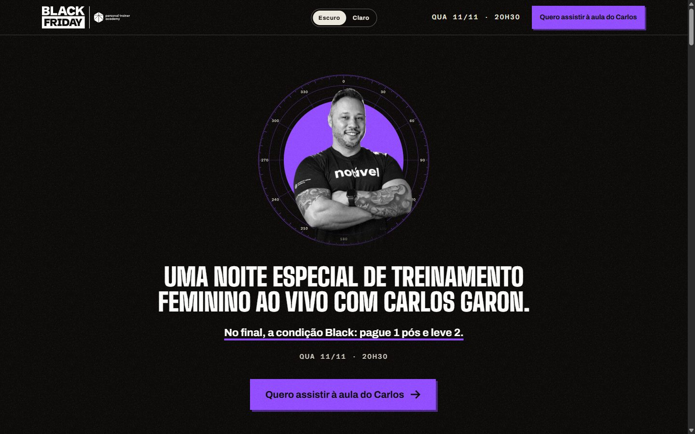 |

Cada pasta em [`previas/`](previas) tem a dobra no computador (1440 px), a dobra no celular (390 px) e a página inteira
no celular, nos dois temas. [`previas/_visao-geral/`](previas/_visao-geral) tem as grades lado a lado.

---

## Elementos gráficos

Elementos criados **a partir do assunto de cada produto** (goniômetro, barra olímpica, anilha, anel, régua polar,
planos anatômicos…), com a cor do próprio produto. Só entram os que foram aprovados e aparecem nas páginas.

| Pasta | O que tem |
|---|---|
| [`elementos/biomecanica`](elementos/biomecanica) | goniômetro circular (90° e 50°), planos anatômicos, prumo, régua, régua polar, numerais |
| [`elementos/bodybuilding`](elementos/bodybuilding) | barra olímpica, anilha, pilha de anilhas, fita métrica, régua polar, numerais |
| [`elementos/feminino`](elementos/feminino) | anel 360°, anel em 4 setores, grade polar, régua polar, calendário, meio-tom |
| [`elementos/todos`](elementos/todos) | folha do kit dourado da **página-mãe** (o kit completo está na biblioteca abaixo) |
| [`elementos/biblioteca-completa`](elementos/biblioteca-completa) | a biblioteca inteira: 15 famílias × 4 produtos × 2 fundos, em `.zip` de SVG |

**Como usar:** arquivos `…__fundo-escuro.svg` têm traço claro (para fundo preto) e `…__fundo-claro.svg` traço escuro
(para fundo papel). Todos são **SVG**, vetor editável. Veja [`elementos/LEIA-ME.md`](elementos/LEIA-ME.md) para a
lista com a explicação de cada um.

---

## Identidade

Em [`marca/`](marca): logos (2 conceitos × 6 cores × 5 versões, SVG + PNG), paleta com variáveis CSS e contraste,
fontes livres (Big Shoulders, Archivo, Azeret Mono, licença OFL) e fundos/texturas aprovados.

**As regras que não mudam, em 1 minuto**

1. **Uma cor por produto.** Dourado só na marca-mãe e na oferta das três juntas.
2. **Títulos** em Big Shoulders 900, caixa-alta · **texto** em Archivo · **contador** em Azeret Mono.
3. **O logo nunca arredonda.** Campanha é reta; conteúdo e gente têm cantos arredondados.
4. **Foto real** recortada para pessoas; IA só para cenário. Texto sempre em fonte, nunca em imagem.
5. **Ordem de leitura:** imagem → título → botão. Uma mensagem por tela, muito respiro.
6. **Espaços** em múltiplos de 12 (12 · 24 · 40). Texto corrido ≥ 16 px, contraste ≥ 4,5:1.
7. **Primeira dobra = tela inteira**, com o botão sempre visível, em qualquer tamanho.

---

## Como rodar o site

Precisa de **Node 22+**.

```bash
cd site
npm install
npm run dev          # http://localhost:3000
npm run build        # gera a pasta out/ (site 100% estático)
npm run start:out    # serve out/ como em produção
npm run check        # build + verificação de cada página + peso
```

A pasta `out/` roda em qualquer hospedagem (Vercel, Hostinger, Netlify…). Já existem pacotes prontos em
[`sites-prontos/`](sites-prontos): `site-raiz.zip` (domínio principal) e `site-subpasta-site.zip`
(`seudominio.com/site/`). Passo a passo de publicação em [`sites-prontos/LEIA-ME.txt`](sites-prontos/LEIA-ME.txt).

**Onde mexer**

| Quero mudar… | Arquivo |
|---|---|
| Textos da campanha | `site/content/` (copy em JSON) e `site/lib/copy.ts` |
| Datas, link do grupo, endpoint do formulário | `site/.env.example` → `.env.local` |
| Cores e tema claro/escuro | `site/styles/tema.css` |
| Dobra das páginas de professor | `site/components/solo/` |
| Elementos usados nas páginas | `site/public/img/` |

---

## Estrutura

```
.
├── previas/          prints atuais das 12 páginas (2 temas, computador e celular)
├── elementos/        kit de elementos por produto + biblioteca completa (SVG)
├── marca/            logos, cores, tipografia, fundos e texturas
├── sites-prontos/    pacotes .zip para publicar (raiz e subpasta)
└── site/             código-fonte (Next.js 16 · React 19 · Tailwind 4 · GSAP)
```

---

## Ainda pendente (do cliente)

- Termo de autorização de imagem dos professores
- Registro da marca (INPI) e canais oficiais (Instagram, WhatsApp, site)
- Endpoint do formulário e link do grupo do WhatsApp
- Valores da oferta (divulgados ao vivo) e dados jurídicos
- Dúvidas de copy: números de alunos, "sem TCC", garantia, bônus do André, e-books

---

<div align="center">

Feito com carinho para a **Personal Trainer Academy**.<br>
<sub>Material de teste · todos os direitos reservados · não indexar</sub>

</div>
